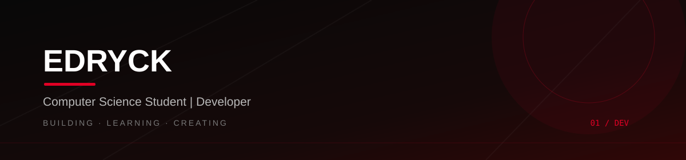

<!-- BANNER -->

  

<h1 align="center">
  Olá, eu sou o Edryck!
  
</h1>

<h3 align="center">
  Graduando em Ciência da Computação · Desenvolvedor · Entusiasta de Tecnologia
</h3>

  

  
  
  

---

<!-- SOBRE MIM -->

<h2 align="center">Sobre mim</h2>

<table align="center" width="100%">
  <tr>
    <td width="65%" valign="middle">
      

        Sou graduando em <strong>Ciência da Computação na Universidade
        Tecnológica Federal do Paraná (UTFPR)</strong>, interessado em
        desenvolvimento de software, tecnologia e resolução de problemas.
      

      

        Tenho experiência acadêmica e prática com diferentes linguagens,
        frameworks e ferramentas, desenvolvendo projetos que exploram
        desde aplicações web até inteligência artificial e engenharia de dados.
      

      
<strong>Áreas de interesse:</strong>

      <ul>
        <li>Engenharia de Software e Desenvolvimento Full Stack</li>
        <li>Inteligência Artificial e Visão Computacional</li>
        <li>Engenharia de Dados e Big Data</li>
        <li>Machine Learning</li>
        <li>Tecnologia Educacional e Desenvolvimento de Jogos</li>
      </ul>
      

        <strong>Objetivo:</strong> Continuar aprendendo, desenvolver
        projetos relevantes e evoluir constantemente como profissional.
      

    </td>
    <td width="35%" align="center" valign="middle">
      
       
      <strong>Edryck</strong>
       
      Ciência da Computação · UTFPR
        
      
    </td>
  </tr>
</table>

---

<!-- TECNOLOGIAS -->

<h2 align="center">Tecnologias e ferramentas</h2>

<strong>Linguagens de programação</strong>

  

<strong>Frameworks e bibliotecas</strong>

  

<strong>Dados e Inteligência Artificial</strong>

  

<strong>Ferramentas e infraestrutura</strong>

  

---

<!-- PROJETOS -->

<h2 align="center">Projetos em destaque</h2>

<table align="center" width="100%">
  <tr>
    <td width="50%" valign="top">
      <h3 align="center">Vision Explain</h3>
      

        
      

      

        Projeto de pesquisa envolvendo modelos de visão e linguagem
        para explicar resultados de visão computacional.
      

      
Python · Inteligência Artificial · Visão Computacional

    </td>
    <td width="50%" valign="top">
      <h3 align="center">Fio Contínuo</h3>
      

        
      

      

        Jogo educacional sobre circuitos elétricos, com exploração,
        montagem e simulação de circuitos de corrente contínua.
      

      
Godot · GDScript · Desenvolvimento de Jogos

    </td>
  </tr>
  <tr>
    <td width="50%" valign="top">
      <h3 align="center">SIH/SUS Pipeline</h3>
      

        
      

      

        Pipeline de Big Data para coleta, processamento e análise
        de dados públicos de saúde do Brasil.
      

      
Python · Engenharia de Dados · Big Data

    </td>
    <td width="50%" valign="top">
      <h3 align="center">Flown</h3>
      

        
      

      

        Aplicação de gerenciamento de tarefas e organização pessoal.
      

      
Consulte o repositório para conferir a stack.

    </td>
  </tr>
</table>

  
  

---

<!-- ESTATÍSTICAS -->

<h2 align="center">Estatísticas do GitHub</h2>

  

---

<!-- COBRINHA -->

<h2 align="center">Minhas contribuições</h2>

  <picture>
    <source
      media="(prefers-color-scheme: dark)"
      srcset="https://raw.githubusercontent.com/Edryck/Edryck/output/github-contribution-grid-snake-dark.svg"
    />
    <source
      media="(prefers-color-scheme: light)"
      srcset="https://raw.githubusercontent.com/Edryck/Edryck/output/github-contribution-grid-snake.svg"
    />
    
  </picture>

---

<!-- CONTATO -->

<h2 align="center">Entre em contato</h2>

  Estou aberto a trocar ideias, conhecer outros desenvolvedores
  e colaborar em projetos.

  
  
  
  

 

  <strong>Obrigado por visitar meu perfil!</strong>
   
  Continue aprendendo. Continue construindo.

<!-- FOOTER -->

  

